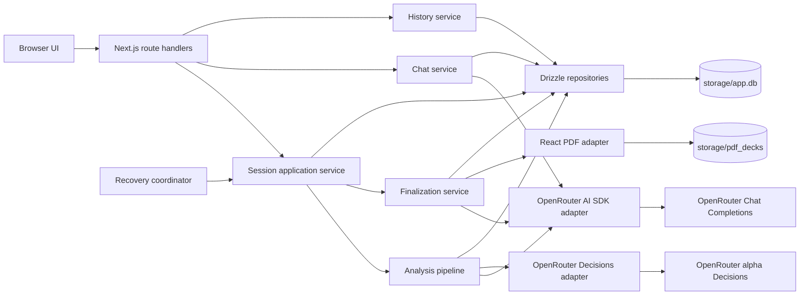
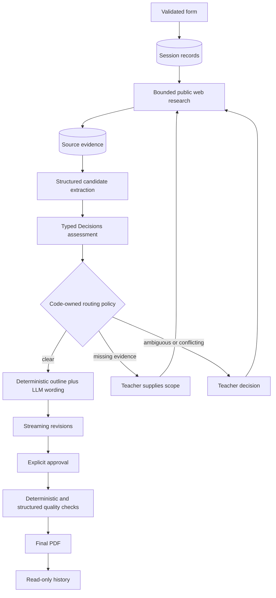
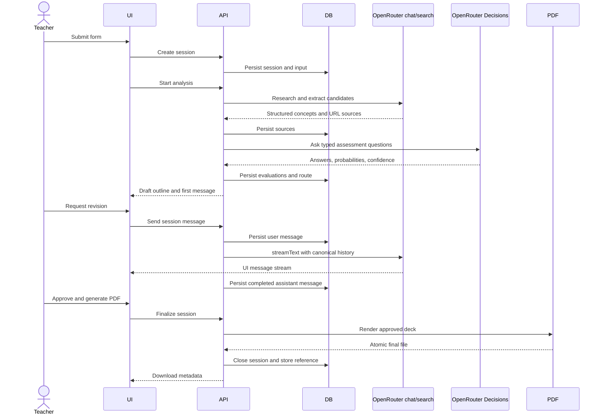
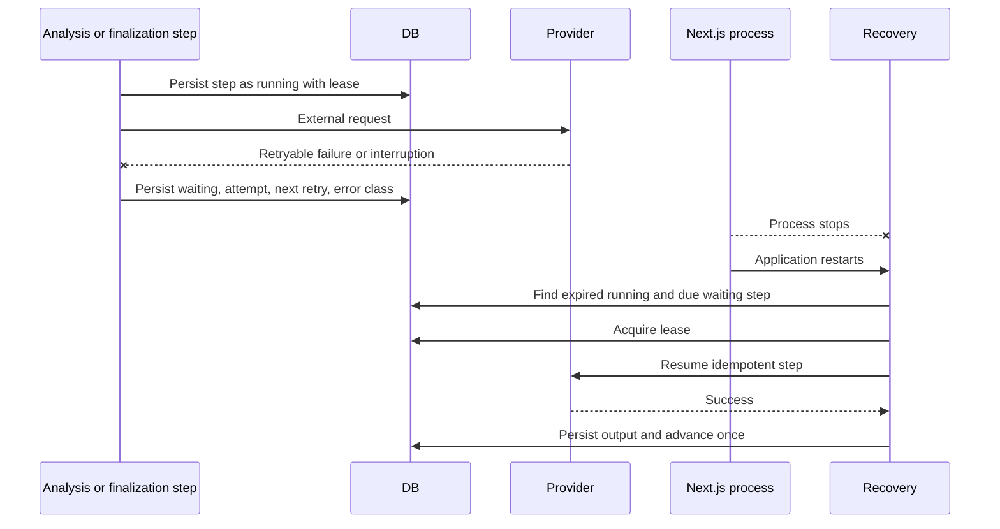

# ADR: Exam Material Generator Copilot — Main Architecture

**Date:** 2026-11-05
**Status:** Accepted
**PRD:** [Exam Material Generator Copilot](../PRD.md)

---

## 1. Overview

The PoC is a local, single-teacher Windows application that turns a book name, chapter, teacher-defined scope, grade, and deck type into an English slide-deck draft, allows revisions through streaming chat, and creates one final PDF after approval. This ADR set resolves the architecture for the form, web research, bounded decision assessment, chat, local persistence, recovery, history, and PDF generation without implementing them.

The current scope has no file upload. Multimodal input is documented only as a rejected or future option because the PRD explicitly excludes uploads.

Related ADRs:

- [ADR-001: AI and Decision Integrations](001-ai-and-decision-integrations.md)
- [ADR-002: Data, Jobs, and Recovery](002-data-jobs-and-recovery.md)
- [ADR-003: Frontend, History, and PDF](003-frontend-history-and-pdf.md)

---

## 2. Technology Documentation References

| Library or service | Context7 ID or official documentation | Used for |
|---|---|---|
| Vercel AI SDK 7 | `/vercel/ai` | `streamText`, `generateText`, `Output.object`, UI message streams, test mocks |
| OpenRouter AI SDK provider | `/openrouterteam/ai-sdk-provider` | OpenRouter chat model, streaming, structured output, web-search server tool |
| Next.js | `/vercel/next.js` | App Router, route handlers, application initialization |
| AI Elements | `/vercel/ai-elements` | Copy-owned chat UI components over `useChat` |
| assistant-ui | `/assistant-ui/assistant-ui` | Evaluated chat UI alternative |
| Drizzle ORM | `/drizzle-team/drizzle-orm-docs` | SQLite schema, queries, and migrations |
| better-sqlite3 | `/wiselibs/better-sqlite3` | Local Windows SQLite driver |
| React PDF renderer | `/diegomura/react-pdf` | Server-side PDF generation |
| OpenRouter Responses API | [Official overview](https://openrouter.ai/docs/api_reference/responses/overview) | Evaluated conversation API alternative |
| OpenRouter Vercel AI SDK integration | [Official guide](https://openrouter.ai/docs/guides/community/vercel-ai-sdk) | Provider adapter verification |
| OpenRouter Decisions API | [Official TypeScript SDK reference](https://openrouter.ai/docs/client-sdks/typescript/sdks/decisions/README.md) | Typed assessment endpoint and failure contract |
| OpenRouter Jev 1.14 | [Official model page](https://openrouter.ai/typesafe/jev-1.14) | Selected first-slice decision model |
| TypeSafe confidence semantics | [Official confidence guide](https://docs.typesafe.ai/confidence) | Probability interpretation and routing policy |
| OpenRouter structured outputs | [Official guide](https://openrouter.ai/docs/guides/features/structured-outputs) | Structured extraction and model capability checks |
| OpenRouter web search | [Official server-tool guide](https://openrouter.ai/tool/web-search/) | Public-source research and citations |
| OpenRouter privacy | [Data collection](https://openrouter.ai/docs/guides/privacy/data-collection), [provider logging](https://openrouter.ai/docs/guides/privacy/provider-logging), [ZDR](https://openrouter.ai/docs/guides/features/zdr) | Data-handling constraints |
| Chat SDK | [Official site](https://chat-sdk.dev/) | Evaluated and rejected messaging-bot SDK |
| Vercel Chatbot template | [Official repository](https://github.com/vercel/chatbot) | Evaluated and rejected full application template |

All documentation was checked on 2026-11-05. Model availability, provider capabilities, alpha API shapes, and scaffolding defaults must be rechecked immediately before implementation.

---

## 3. System Architecture

### 3.1 Pattern

Use a modular monolith in one Next.js App Router application. Browser UI and server route handlers share domain types, while server-only modules own OpenRouter calls, SQLite, filesystem access, recovery, and PDF rendering. Run all database, PDF, and provider routes in the Node.js runtime, never Edge runtime.

Only one session may be active at a time. SQLite and the local filesystem are the system of record; neither OpenRouter chat nor Responses state is authoritative.

### 3.2 Repository structure

| Path | Responsibility |
|---|---|
| `app/src/app/` | App Router pages and route handlers |
| `app/src/components/` | Form, analysis, chat, outline, history, and shared UI |
| `app/src/components/ai-elements/` | Copy-owned AI Elements components |
| `app/src/domain/` | Session state machine, decision policy, deck rules, schemas, errors |
| `app/src/server/ai/` | Chat, structured extraction, web search, and Decisions adapters |
| `app/src/server/db/` | Drizzle schema, repositories, migrations, connection setup |
| `app/src/server/jobs/` | Analysis orchestration, retry leases, startup recovery |
| `app/src/server/pdf/` | Deterministic deck document and atomic file write |
| `app/src/server/prompts/` | Versioned prompt and guidance files by deck type |
| `app/tests/` | Unit, integration, provider-contract, and E2E support |
| `storage/app.db` | Local SQLite database, excluded from Git |
| `storage/pdf_decks/` | Final PDFs, excluded from Git except an optional placeholder |

Dependencies point inward: UI and route handlers depend on application services; services depend on domain ports; provider, database, and PDF adapters implement those ports. Domain modules do not import Next.js, SDKs, SQLite, React, or filesystem APIs.

### 3.3 Technology stack

| Layer | Selected technology | Reason |
|---|---|---|
| Runtime | Supported Node.js LTS on Windows 11 | Required by Next.js and native SQLite bindings |
| Full-stack framework | Current stable Next.js, App Router | One local process for UI and server routes |
| Language | TypeScript with `strict: true` | Shared contracts and compile-time checks |
| Styling | Tailwind CSS and existing design tokens | Required by AI Elements and project visual guidance |
| Chat core | AI SDK 7 `streamText` and `useChat` | Current streaming protocol and typed UI messages |
| Chat provider | `@openrouter/ai-sdk-provider` | Direct OpenRouter support for AI SDK streaming, tools, sources, and structured output |
| Decision provider | `@openrouter/sdk` alpha Decisions client | Separate typed endpoint; verified adapter exists |
| Chat UI | AI Elements over AI SDK UI | Copy-owned, composable components without a second runtime abstraction |
| Validation | Zod | Shared form, API, structured-output, and persisted JSON validation |
| Database | SQLite with Drizzle ORM and better-sqlite3 | Small local dataset, migrations, type-safe queries, Windows support |
| PDF | `@react-pdf/renderer` Node API | Direct server-side PDF creation without Office or browser automation |
| Browser testing | Playwright | Required real-browser E2E and manual QA flow |
| Unit/integration testing | Vitest, React Testing Library, AI SDK test helpers | Fast TDD and deterministic streaming tests |

### 3.4 Initialization

Do not run initialization until the implementation plan is approved. The implementation agent must first make `app/` empty by handling the current placeholder `app/README.md` as an explicit reviewed change, then run:

`npx create-next-app@latest app --ts --eslint --tailwind --app --src-dir --use-npm --import-alias "@/*" --empty --disable-git --no-agents-md --no-react-compiler --no-cache-components --yes`

After scaffolding, verify that `strict` remains enabled in `tsconfig.json`, pin resolved dependency versions in `package-lock.json`, and use only npm commands from `app/`. React Compiler and Cache Components are excluded from the first slice to avoid unrelated behavior and caching decisions.

---

## 4. Module Structure and Dependencies

| Module | Responsibility | Depends on |
|---|---|---|
| Session application service | Enforce state transitions and one-active-session rule | Domain policy, repositories, job coordinator |
| Analysis pipeline | Research, extract candidates, assess, route, and create outline | Search adapter, structured LLM adapter, decision adapter, prompt repository |
| Chat service | Validate open session, persist user message, stream response, persist completion | Chat adapter, repositories, deck rules |
| Finalization service | Lock approval, run checks, render final PDF, close session | Quality service, PDF adapter, repositories |
| Recovery coordinator | Lease and resume interrupted retryable steps | Session repository, clock, analysis/finalization services |
| History service | Search, filter, inspect, download, and delete sessions | Repositories, PDF storage |
| OpenRouter chat adapter | AI SDK model, web search, sources, structured extraction | `@openrouter/ai-sdk-provider` |
| OpenRouter decision adapter | Typed bounded assessments | `@openrouter/sdk` alpha Decisions |
| SQLite repositories | Transactional local persistence | Drizzle, better-sqlite3 |
| PDF adapter | Render and atomically store one final PDF | React PDF renderer, filesystem |

The decision adapter and chat adapter are separate integrations even though they share one server-side OpenRouter key. They must not share request DTOs or assume identical model capabilities.

---

## 5. Core Data Models

Detailed storage design is in ADR-002. The application layer uses these concepts:

| Model | Key fields | Relationships |
|---|---|---|
| Session | ID, locale, status, current step, retry metadata, timestamps | Owns all other records |
| Form input | Book, chapter, teacher scope, grade, deck type, focus | Exactly one per session |
| Source evidence | URL, title, retrieved time, supported claim, warning | Many per session |
| Decision evaluation | Criterion, question type, answer, probabilities, confidence, route, policy version | Many per session and analysis run |
| Slide deck | Structured draft, prompt versions, quality result, approval, final PDF path | Zero or one per session |
| Chat message | Stable ID, role, ordered typed parts, status, timestamp | Many ordered messages per session |
| PDF action | Generation or download, outcome, timestamp | Many audit actions per final deck |

Persist raw provider response metadata needed for diagnosis, model ID, request ID, and usage, but never keys, hidden reasoning, or personal data.

---

## 6. API Contracts

All inputs are schema validated. Error responses contain a stable application code, user-safe message key, retryable flag, and optional field errors. Provider bodies and secrets are never returned.

| Method and path | Purpose | Success | Main errors |
|---|---|---|---|
| `POST /api/sessions` | Create the only active session from validated form input | `201`, session ID and status | `400` invalid input, `409` active session exists |
| `POST /api/sessions/{id}/analysis` | Start or resume bounded analysis | `200` completed state or `202` waiting/retry state | `404`, `409` invalid state, provider failure persisted |
| `GET /api/sessions/{id}` | Poll complete session view | `200`, session projection | `404` |
| `POST /api/sessions/{id}/resolution` | Record teacher choice for unresolved evidence | `200`, new state | `400`, `409` no pending decision |
| `POST /api/chat` | Persist one teacher message and stream assistant UI message parts | AI SDK UI message stream | `400`, `404`, `409` closed/review-blocked, streamed provider error |
| `POST /api/sessions/{id}/finalize` | Approve, validate, generate PDF, and close | `201`, final metadata | `409` unresolved/closed, `422` quality failure, retryable provider/PDF failure |
| `GET /api/sessions` | Search and filter history | Paginated list | `400` invalid filter |
| `GET /api/sessions/{id}/pdf` | Download final PDF | PDF stream | `404` absent/deleted |
| `DELETE /api/sessions/{id}` | Confirmed permanent deletion | `204` | `404`, `409` active operation, `503` deletion pending retry |
| `GET /api/health` | Report local DB, storage, and configuration readiness | Component status without secrets | `503` unavailable component |

The chat request identifies the session and contains the new UI message. The server loads canonical history from SQLite, validates message IDs, appends the user message once, and constructs model history. The client never sends form context, prompt rules, provider configuration, or trusted decision state.

---

## 7. Environment Variables

Use `.env.example` as the committed contract and a local uncommitted framework-loaded environment file for real values.

| Variable | Purpose | Required | Example |
|---|---|---:|---|
| `OPENROUTER_API_KEY` | Server-only credential shared by chat and Decisions adapters | Yes for live calls | Empty in committed file |
| `LLM_MODEL` | Exact OpenRouter model ID for drafting and chat | Yes | `openai/gpt-5.2` |
| `DECISION_MODEL` | Exact OpenRouter Decisions model ID | Yes | `typesafe/jev-1.14` |

Database and PDF paths are product invariants from the PRD, not secrets or environment-specific deployment settings. Resolve them to absolute paths on the server and reject paths outside the repository `storage/` directory.

---

## 8. Technical Decisions

### 8.1 Modular local Next.js monolith

**Status:** Accepted
**Context:** The PoC is single-user, local Windows software with one active session. A distributed system would add deployment and coordination work without product value.
**Decision:** Use one Next.js Node process with explicit internal modules and local persistence.
**Rejected alternatives:**

- Separate frontend, API, worker, and dashboard services: unnecessary operational overhead.
- Vercel/serverless deployment: incompatible with required local SQLite and filesystem durability without replacing storage.

**Consequences:**

- (+) One startup command and direct local storage.
- (-) Startup recovery must be safe against development reloads and process interruption.

**Review trigger:** Any cloud deployment, multiple users, or more than one concurrent active session.

### 8.2 Start from create-next-app, not a chat template

**Status:** Accepted
**Context:** The current Vercel Chatbot template includes authentication, Neon Postgres, Vercel Blob, AI Gateway, and deployment assumptions. The current product deliberately excludes those features.
**Decision:** Initialize a minimal Next.js app and add only selected packages.
**Rejected alternatives:**

- Vercel Chatbot template: useful reference, but removing its production SaaS stack is more work than adding this PoC's bounded features.
- Current `chat-sdk.dev`: it is a multi-platform messaging-bot SDK for Slack, Teams, Discord, and similar platforms, not the former web-chat starter.

**Consequences:**

- (+) Architecture directly matches local SQLite and no-auth scope.
- (-) History, session state, and form-to-chat flow must be implemented explicitly.

**Review trigger:** Product scope changes to a hosted multi-user chatbot or messaging-platform bot.

### 8.3 AI SDK Chat Completions path over OpenRouter Responses API

**Status:** Accepted
**Context:** AI SDK 7 and the OpenRouter provider expose current `streamText`, `useChat`, tools, sources, and structured outputs over OpenRouter Chat Completions. OpenRouter Responses API is OpenAI-compatible but currently stateless and rejects stored-response continuation.
**Decision:** Use the OpenRouter AI SDK provider for drafting and streaming chat. Keep conversation state in SQLite. Do not mix the Responses protocol into the first slice.
**Rejected alternatives:**

- Direct OpenRouter Responses API: duplicates transport work without reducing local persistence needs.
- Direct fetch to Chat Completions: loses AI SDK UI stream and testing abstractions.

**Consequences:**

- (+) One supported path from `streamText` to `useChat`.
- (-) OpenRouter-specific capabilities remain behind provider options and need contract tests.

**Review trigger:** The Responses API gains a required capability unavailable through the AI SDK provider, or the provider stops supporting AI SDK 7.

### 8.4 AI Elements over assistant-ui

**Status:** Accepted
**Context:** Both support streaming. AI Elements supplies copy-owned shadcn components that work directly with `useChat`; assistant-ui adds its own runtime and state abstraction.
**Decision:** Use selected AI Elements components and retain AI SDK UI as the only chat state protocol.
**Rejected alternatives:**

- assistant-ui: capable, but the extra runtime is not justified for one thread and a custom form/outline/history workspace.
- Fully custom chat components: duplicates accessible message and composer behavior.

**Consequences:**

- (+) Components can be adapted to project design tokens and non-chat panels.
- (-) Copied components become application-owned and must be maintained.

**Review trigger:** Need for complex branching threads, many interactive tools, or assistant-ui features that would replace substantial custom code.

### 8.5 Option fit summary

| Option | Fit for this PRD | Decision |
|---|---|---|
| Vercel AI SDK 7 Core and UI | Best fit for Next.js streaming, typed structured output, sources, and offline mock helpers | Select |
| `@openrouter/ai-sdk-provider` | Best fit for OpenRouter chat streaming, structured output, and the current web-search server tool | Select for generative calls |
| OpenRouter alpha Decisions through `@openrouter/sdk` | Best fit for separate typed decisions and probabilities; alpha risk is contained behind one adapter | Select for bounded assessment |
| OpenRouter Responses API | Capable and stateless, but adds a second generative transport while local SQLite still owns full history | Do not use in first slice |
| Current Chat SDK at `chat-sdk.dev` | Targets Slack, Teams, Discord, WhatsApp, and similar bots; it is not the old web-chat template | Reject |
| Vercel Chatbot template | Feature-rich, but its auth, Neon, Blob, AI Gateway, and hosted assumptions conflict with the local PoC | Use only as reference |
| AI Elements | Direct `useChat` fit, copy-owned shadcn components, easy design-token adaptation | Select |
| assistant-ui | Strong alternative but adds a runtime abstraction not needed for one conversation | Reject for first slice |
| Custom Next.js history route | Shares domain rules, localization, download, and deletion behavior | Select |
| Datasette or Streamlit browser | Adds a second process and exposes database-oriented UX | Reject |

---

## 9. Diagrams

### 9.1 Component diagram

### 9.2 Main data flow

### 9.3 Happy-path sequence

### 9.4 Failure and restart recovery

---

## 10. Testing Strategy

### 10.1 Philosophy

Use Red–Green–Refactor for each feature. Provider SDKs stay behind ports so most behavior is deterministic. A mock or fixture does not complete a provider integration; each external adapter requires a separate live smoke test with synthetic data and a server-only key.

### 10.2 Layers

| Layer | Scope | Tools and constraints |
|---|---|---|
| Unit | Domain state machine, decision routing, deck rules, validation, retry classification | Vitest; all dependencies replaced with internal fakes |
| Component | Form, bilingual UI, chat rendering, pending and error states | React Testing Library and jsdom |
| Integration | Route handlers, SQLite repositories, migrations, PDF adapter, AI SDK stream protocol | Vitest, temporary SQLite database, AI SDK `MockLanguageModelV4`, `simulateReadableStream` |
| Provider contract | OpenRouter chat/search and Decisions request/response compatibility | Fresh authorized live capture with synthetic content; sanitized fixture; separate live smoke |
| E2E | Real form-to-analysis-to-chat-to-final-PDF and history/deletion | Playwright, real local stack, real OpenRouter; no mocks |
| Manual QA | Real browser behavior and design comparison | Playwright screenshots of every touched screen and console inspection |

### 10.3 Key cross-system scenarios

1. Valid supported scope reaches draft chat with stored evidence and evaluations.
2. Missing scope pauses and resumes after teacher clarification.
3. Conflicting evidence requires an explicit teacher choice.
4. Streaming persists exactly one user and one assistant message after reconnect-safe completion.
5. Provider interruption persists state and resumes after application restart without duplicate effects.
6. Quality failure blocks PDF creation and names the affected slide.
7. Approval produces one PDF, closes the session, and prevents all later edits.
8. Confirmed deletion removes database content and the linked file; canceled deletion changes nothing.
9. UI labels switch PL/EN while all educational content stays English.
10. Missing live credentials block live E2E and provider smoke checks; they are never reported as passes with mocks.

### 10.4 Technical acceptance criteria

- **TAC-000-01:** TypeScript compilation passes with `strict: true` and no introduced warnings.
- **TAC-000-02:** No client bundle, response body, log entry, fixture, or committed file contains `OPENROUTER_API_KEY`.
- **TAC-000-03:** All SQLite, filesystem, PDF, and provider route handlers declare Node.js runtime behavior.
- **TAC-000-04:** The application rejects creation of a second active session with `409`.
- **TAC-000-05:** Restarting the server with one interrupted retryable session resumes only its incomplete idempotent step.
- **TAC-000-06:** Full verification records build, test counts and skips, successful startup, E2E, and manual QA as separate results.

---

## 11. Open Questions and Review Risks

- OpenRouter Decisions is an alpha API; its client types and endpoint shape may change. Pin the SDK version and isolate the adapter.
- `typesafe/jev-1.14` and `openai/gpt-5.2` were available on 2026-11-05. Verify both through the Models API before implementation and each release.
- ZDR does not cover third-party web-search engines. Only synthetic, non-personal content may be sent, and the chosen search engine's policy must be reviewed.
- The existing Instrument Sans asset requires license verification before application use. Until verified, use the documented fallback stack.
