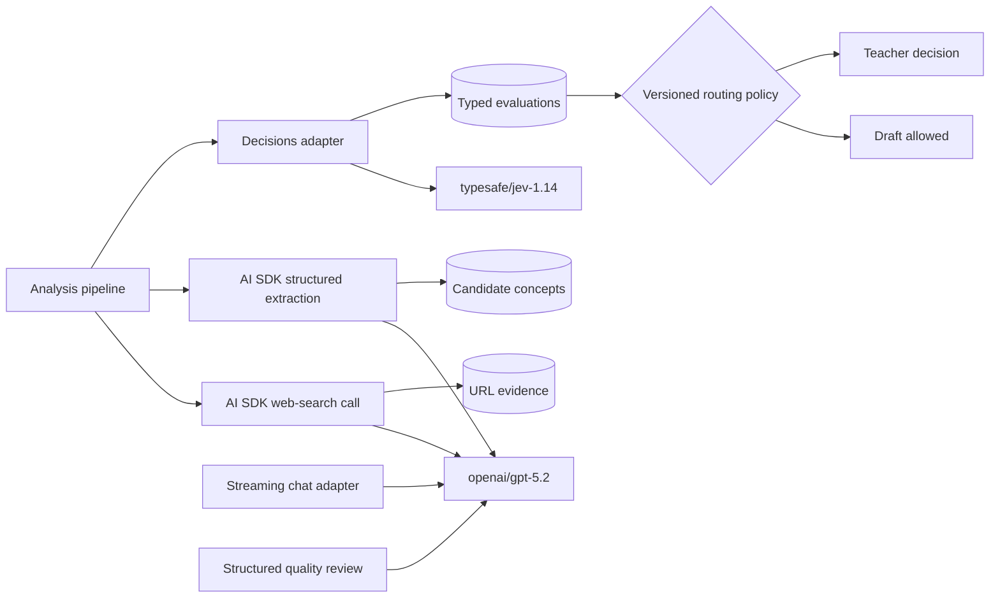
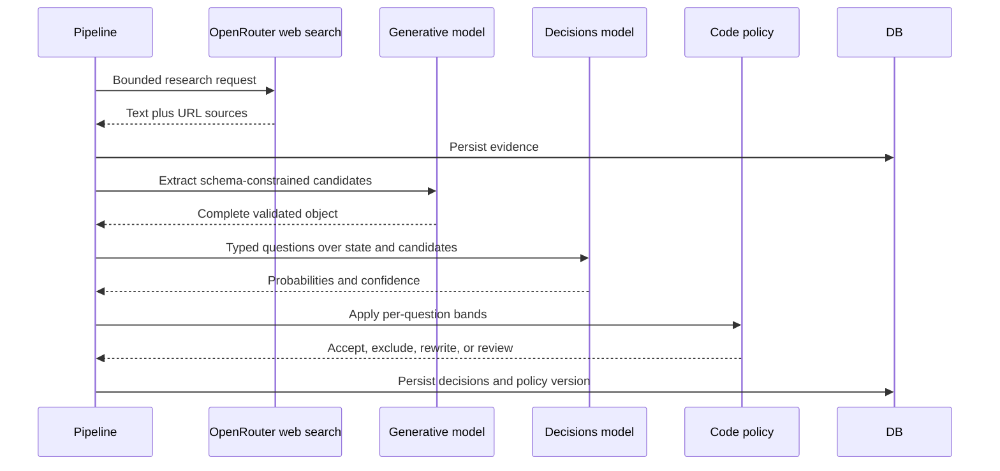
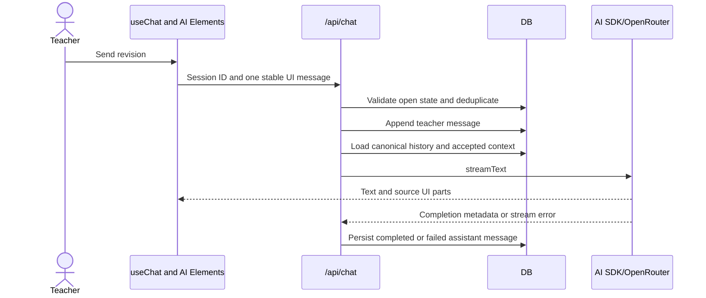

# ADR-001: AI and Decision Integrations

**Date:** 2026-11-05
**Status:** Accepted
**Relates to:** [ADR-000](000-main-architecture.md)

---

## 1. Scope

This ADR defines public-source research, candidate concept extraction, bounded decision assessment, code-owned routing, slide drafting, chat streaming, privacy, and provider failures. It does not define SQLite schema mechanics, UI layout, or PDF rendering.

No upload endpoint or attachment control exists in this slice. Image and PDF capabilities were researched only to document why they are not part of the selected flow.

---

## 2. Technology Documentation References

| Technology | Context7 ID or official documentation | Used for |
|---|---|---|
| Vercel AI SDK 7 | `/vercel/ai` | `streamText`, `generateText`, `Output.object`, UI stream, sources, citations, mock model |
| OpenRouter AI SDK provider | `/openrouterteam/ai-sdk-provider` | Chat Completions adapter, provider tools, structured outputs, routing options |
| OpenRouter TypeScript SDK | [Official client docs](https://openrouter.ai/docs/client-sdks/typescript/overview) | Typed alpha Decisions client |
| Decisions endpoint | [Official reference](https://openrouter.ai/docs/client-sdks/typescript/sdks/decisions/README.md) | Request, answers, retryable errors, alpha warning |
| Jev 1.14 | [Official OpenRouter page](https://openrouter.ai/typesafe/jev-1.14) | Selected decision model ID and supported modalities |
| Jev question types | [Choice](https://docs.typesafe.ai/primitives/choice), [Noul](https://docs.typesafe.ai/primitives/noul), [Score](https://docs.typesafe.ai/primitives/score) | Typed question semantics |
| Confidence | [TypeSafe confidence guide](https://docs.typesafe.ai/confidence) | Difference between probability and confidence |
| Structured outputs | [OpenRouter guide](https://openrouter.ai/docs/guides/features/structured-outputs) | Model and endpoint capability constraints |
| Web search | [OpenRouter server tool](https://openrouter.ai/tool/web-search/) | Search execution and source citations |
| Multimodal Decisions | [OpenRouter guide](https://openrouter.ai/docs/guides/community/multimodal-decisions) | Future image assessment constraints |
| Extractions API | [OpenRouter guide](https://openrouter.ai/docs/guides/community/extractions) | Evaluated future PDF extraction option |

---

## 3. Component Design

### 3.1 Provider separation

Use two server-only adapters:

1. **Generative adapter:** AI SDK 7 with `@openrouter/ai-sdk-provider`, calling OpenRouter Chat Completions for web research, structured candidate extraction, slide drafting, quality review, and streaming conversation.
2. **Decision adapter:** `@openrouter/sdk` alpha Decisions client, calling the dedicated Decisions endpoint for typed answers and probabilities.

The Decisions endpoint is not an AI SDK language model and must not be passed to `streamText`, `generateText`, or `useChat`. The AI SDK OpenRouter provider does not replace the Decisions client.

### 3.2 Selected models

| Role | Model ID | Rationale | Stability |
|---|---|---|---|
| Drafting, research, quality, and chat | `openai/gpt-5.2` | Current OpenRouter model supports text, image/file input, tools, streaming, and structured outputs; the PoC uses text only | Stable model ID but provider endpoints and availability can change |
| Bounded assessment | `typesafe/jev-1.14` | Typed Noul, Choice, and Score answers with probabilities; dedicated TypeScript SDK path; current fixed version | Decisions API is alpha; model version is fixed rather than `latest` alias |

Both IDs are configuration values and are validated at startup. Do not silently fall back to a model that lacks the required tools or structured-output parameters. A model change requires the synthetic evaluation suite and live smoke tests to pass again.

### 3.3 Analysis stages

The analysis pipeline is ordered and persisted after every stage:

1. Normalize and validate the form and teacher scope.
2. Determine whether the teacher supplied enough scope to search without guessing.
3. Use the OpenRouter web-search server tool only when chapter knowledge is not sufficiently supported.
4. Collect URL sources, titles, retrieved timestamps, snippets or claims, and warnings.
5. Use non-streaming AI SDK structured output to extract a bounded list of candidate concepts and evidence references.
6. Validate the complete structured object with Zod. Partial streamed objects are not accepted because AI SDK documentation states partial structured output cannot be fully schema validated.
7. Send form context, candidate concepts, and concise evidence text to Jev in one Decisions request containing independent typed questions.
8. Apply deterministic routing policy in application code.
9. If clear, generate the initial structured slide outline under code-owned deck rules, then draft English wording.
10. If unresolved, persist the issue and wait for teacher input; do not start ordinary chat edits or PDF generation.

Web research and structured extraction may use the normal model before the interactive conversation begins. The phrase “decision before ordinary conversation” means the teacher cannot enter the open revision chat until the bounded assessment and any required resolution are complete.

### 3.4 Decision questions

Each assessment stores the exact question version, criteria version, model, answer, probability distribution, confidence where present, and resulting route.

| Criterion | Jev primitive | Outcomes or interpretation | Code-owned route |
|---|---|---|---|
| Concept matches requested scope | Noul per candidate | Probability that the candidate belongs to the declared scope | Include, exclude, or review band |
| Evidence sufficiently covers scope | Noul | Probability that available sources support a chapter-specific draft | Proceed, request scope/source, or review |
| Content is appropriate for selected grade | Choice | `too_easy`, `appropriate`, `too_difficult`, `insufficient_evidence` | Proceed only on calibrated `appropriate`; otherwise revise or review |
| Candidate extraction is evidence-supported | Noul per candidate | Probability that evidence supports the extracted concept | Keep, remove, or review band |
| Sources materially conflict | Noul | Probability that sources disagree in a way affecting the deck | Proceed, human decision, or review band |

Do not ask Jev to generate concepts, explanations, citations, or slide text. It returns typed decisions, not free-form prose. The ordinary model produces candidate concepts and teacher-facing explanations; application code owns all routing.

### 3.5 Probability and uncertainty semantics

- For Noul, the returned value is the probability of “yes.” A value near zero can be a confident “no”; it is not uncertainty.
- For Choice, use the probability of the option the code would act on. `confidence` only summarizes concentration of the distribution and is not an independent probability of correctness.
- For Score, inspect the distribution and confidence; do not use a position alone when distant levels have meaningful probability.
- Missing evidence, conflicting evidence, and ambiguous classification are distinct outcomes and are persisted separately.
- No provider score guarantees correctness or curriculum coverage.

Provisional routing bands use the documented Jev starting point only until calibrated:

| Question | Automatic positive | Automatic negative | Middle band |
|---|---:|---:|---|
| Concept scope match | `p >= 0.70` include | `p <= 0.30` exclude | Ask for review or more evidence |
| Evidence-supported extraction | `p >= 0.70` keep | `p <= 0.30` remove | Review |
| Evidence coverage | `p >= 0.80` proceed | `p <= 0.30` request scope/source | Review |
| Material source conflict | `p >= 0.70` teacher decision | `p <= 0.30` proceed | Review |
| Grade Choice | `appropriate >= 0.70` and selected option is `appropriate` | Selected `too_easy` or `too_difficult` at `>= 0.70` triggers rewrite | All other distributions require review |

These values are not accepted production constants until the evaluation cases show the desired routing. Store them in one versioned decision-policy module, not prompts, environment variables, or provider settings.

### 3.6 Calibration and evaluation cases

Before enabling automatic routes, create at least 30 synthetic cases: at least two clear positive, two clear negative, and two ambiguous cases for each of the five criteria. Cases must include:

- clearly supported grade-appropriate vocabulary;
- a clearly unrelated concept that should be confidently excluded;
- a vague chapter title with no reliable evidence;
- two synthetic sources describing different editions or chapter scopes;
- material clearly too easy and clearly too difficult for the selected grade;
- grammatically valid but thematically irrelevant content;
- a source set with one weak outlier and two agreeing sources;
- missing teacher scope after the model cannot identify the chapter.

Record expected route rather than an expected exact float. Select thresholds that minimize incorrect automatic inclusion and incorrect automatic “no conflict” routes while keeping the review band usable. Preserve the evaluation dataset, model ID, question versions, threshold version, date, and observed confusion counts.

### 3.7 Web research

Use the provider-defined `openrouter:web_search` server tool through the AI SDK provider. Pin the search engine only after its privacy and result quality are evaluated; the first implementation may use `auto` with synthetic content. Persist source URL parts emitted by AI SDK and verify that teacher-facing claims retain their citations.

Web search is used only when chapter scope is not supported. The model may issue a bounded maximum of two search calls and receive a bounded number of results per call. If no reliable public evidence is found, ask the teacher for scope or a nominated public source. Do not crawl paywalls, authentication barriers, or publisher-only content.

Search citations appear in chat and history, not in the PDF.

### 3.8 Chat streaming and persistence

- The client uses AI SDK 7 `useChat` with `DefaultChatTransport` pointed at `/api/chat`.
- The route converts validated UI messages to model messages and uses `streamText`.
- The response uses the AI SDK 7 UI message stream transformation, with URL sources enabled.
- The server persists the teacher message before calling OpenRouter.
- The server persists the completed assistant UI message and source parts in the stream completion callback.
- If the stream terminates with an error, persist the assistant message as incomplete or failed; never present it as completed.
- A client retry uses stable message and request IDs so it cannot append the same teacher turn twice.
- The server reconstructs full model history from SQLite and injects form context, accepted decisions, current outline, and prompt rules. It does not trust client-supplied history as authoritative.

### 3.9 Prompt and rule ownership

Maintain separate versioned prompt files for Flashcard Slides, Summary Deck, and Quiz & Practice Deck. Maintain age-adaptation guidance and slide styling examples as separate files injected by the server.

Hard requirements stay in code and schema validation:

- grade must be 1–4;
- deck must be 8–12 slides unless a documented exception is shown before approval;
- approximately 10 slides is the target;
- at most one task or primary learning item per content slide;
- intro, concepts, practice, and answer key structure;
- sources and internal scores excluded from PDF;
- final content in English;
- closed sessions immutable.

Prompts may explain or realize these constraints but cannot redefine them.

### 3.10 Multimodal and PDF input finding

Multimodal input is not selected. Research found that the protocols are not interchangeable:

- AI SDK supports image and file parts only for providers and models that advertise them.
- `openai/gpt-5.2` currently advertises text, image, and file input through OpenRouter, but this PoC must reject attachments.
- Jev 1.14 accepts text and image Decisions input, not PDF input.
- Decisions media uses a top-level `state` format that differs from Chat Completions and Responses input parts.
- OpenRouter Extractions is a separate alpha endpoint for typed fields from text, images, and PDFs.

If upload returns to scope, update the PRD and add a separate ADR covering file limits, malware handling, OCR/extraction, image compression, rights, provider limits, and multimodal evaluation. Do not bolt attachments onto the existing text pipeline.

### 3.11 Privacy and security

- All provider keys remain server-side and never enter client props, browser storage, source maps, prompts, logs, or committed fixtures.
- Reject or redact personal data before any provider or search call. The product policy prohibits personal data rather than trying to make its processing safe.
- Set OpenRouter request routing to require ZDR where supported and configure account privacy to disallow training. This does not make web-search engines ZDR.
- Disable prompt/completion logging in OpenRouter. Local application logs contain IDs, durations, status codes, model ID, and token usage, not prompt bodies.
- Use synthetic book names, chapters, sources, and educational content for development, evaluation, fixtures, live smoke, and E2E.

---

## 4. Data Structures

### 4.1 Structured candidate extraction

The validated object contains:

- analysis version;
- normalized requested scope;
- candidate concepts, each with stable ID, concise English label, evidence-source IDs, and extraction note;
- evidence gaps;
- source conflicts detected by the ordinary model as candidates for bounded assessment;
- proposed age-level observations;
- no confidence invented by the generative model.

### 4.2 Decision result

Each stored evaluation contains:

- evaluation ID and session ID;
- criterion and subject ID;
- primitive type;
- model and provider request ID;
- selected answer or Noul value;
- full probability distribution where returned;
- confidence where returned;
- question and criteria version;
- policy version and thresholds applied;
- route: `accept`, `exclude`, `rewrite`, `request_scope`, `request_source`, or `human_review`;
- created timestamp and usage metadata.

### 4.3 Chat UI message

Persist stable message ID, role, ordered typed parts, status, created timestamp, and provider metadata. Supported first-slice parts are text and URL source. Reasoning traces are not displayed or stored. Tool execution details are stored only as bounded operational metadata required for source auditing.

---

## 5. Interface Contracts

### 5.1 Generative adapter

Operations:

- research scope with web search and return a bounded evidence package;
- extract candidates as a fully validated structured object;
- create or revise a structured slide outline;
- stream a chat turn as AI SDK UI message parts;
- perform a structured thematic, linguistic, age, and answer-consistency review.

It returns normalized domain errors rather than SDK errors.

### 5.2 Decision adapter

Input contains fixed model ID, bounded state, and a versioned map of Noul or Choice questions. Output contains typed answers, model, provider, request ID, usage, and raw response hash. Reject unknown question types, missing answers, non-finite probabilities, distributions outside tolerance of 1, and unexpected model IDs.

### 5.3 Error classification

| Provider result | Application behavior |
|---|---|
| `400`, schema/capability error | Non-retryable integration failure; preserve session and show safe error |
| `401`, `403` | Non-retryable configuration failure; never ask teacher for a key in UI |
| `402` | Non-retryable credit failure until configuration changes |
| `408`, `429`, `500`, `502`, `503`, `524`, `529`, network timeout | Retryable with persisted bounded backoff |
| Malformed structured output | One bounded repair/retry only when supported; otherwise review/error |
| Stream error after partial output | Mark assistant turn incomplete; do not persist it as accepted deck content |
| Search returns no usable sources | Request scope or nominated source; not a provider retry |

---

## 6. Technical Decisions

### 6.1 Jev 1.14 for the first bounded decision slice

**Status:** Accepted
**Context:** The PoC needs typed probabilities for classification and routing, not free-form explanations. Jev has explicit question primitives, documented probability semantics, and a verified OpenRouter TypeScript SDK endpoint.
**Decision:** Use fixed model `typesafe/jev-1.14` through `@openrouter/sdk` alpha Decisions.
**Rejected alternatives:**

- Use the chat LLM with JSON schema for decisions: produces typed shape but not the dedicated decision probabilities or semantics.
- Use `~typesafe/jev-latest`: silent model upgrades would invalidate calibrated thresholds.
- Select a less documented Decisions model: current catalog has alternatives, but the first slice favors documented semantics and adapter support over provider comparison.

**Consequences:**

- (+) Code receives typed decisions and full distributions.
- (-) Alpha endpoint and model-specific semantics create migration risk.

**Review trigger:** Alpha request or response changes, fixed model removal, or evaluation performance below the accepted routing target.

### 6.2 Code-owned routing, calibrated thresholds

**Status:** Accepted
**Context:** Confidence is derived from the probability distribution and is not a guarantee. Different questions require different risk bands.
**Decision:** Keep routes and thresholds in versioned code, calibrate with representative synthetic cases, and persist the policy version with every decision.
**Rejected alternatives:**

- One global confidence threshold: conflates question semantics and option counts.
- Let the LLM decide escalation: makes routing non-deterministic and hard to audit.

**Consequences:**

- (+) Every automatic route is reproducible.
- (-) Model, prompt, criteria, or threshold changes require re-evaluation.

**Review trigger:** More than 10% of reviewed cases reveal a wrong automatic route, or the model/question version changes.

### 6.3 Structured non-streaming extraction before Decisions

**Status:** Accepted
**Context:** Jev classifies state but does not generate free-form core concept lists. Candidate concepts still need bounded extraction from evidence.
**Decision:** Use AI SDK non-streaming structured output with a Zod schema, then validate candidates through Decisions.
**Rejected alternatives:**

- OpenRouter Extractions alpha API: adds a third alpha integration and is unnecessary for text-only input.
- Stream partial structured concepts: partial objects are not fully schema-valid and complicate persistence.

**Consequences:**

- (+) Candidate shape is typed and can carry source references.
- (-) Extraction quality remains generative and needs downstream assessment.

**Review trigger:** PDF/image upload returns, or text extraction repeatedly fails the evaluation set.

---

## 7. Diagrams

### 7.1 AI component diagram

### 7.2 Assessment sequence

### 7.3 Streaming chat sequence

---

## 8. Testing Strategy

### 8.1 Test scenarios

| Scenario | Type | Input | Expected output | Edge cases |
|---|---|---|---|---|
| Confident concept inclusion | Unit/evaluation | Supported concept and agreeing evidence | Include route | Probability exactly on threshold |
| Confident exclusion | Unit/evaluation | Unrelated concept | Exclude route, not uncertain | Noul near zero |
| Ambiguous concept | Unit/evaluation | Partial evidence | Human-review route | Middle-band boundaries |
| Source conflict | Unit/evaluation | Two incompatible synthetic editions | Teacher decision required | One weak outlier |
| Grade fit | Unit/evaluation | Grade 1 versus advanced instructions | Rewrite or review | Selected option with low top probability |
| Structured extraction | Integration | Synthetic sources | Schema-valid candidates with source IDs | Missing source reference, extra field |
| Web research | Provider contract | Synthetic unknown chapter | URL source parts and citations | No results, search tool unavailable |
| Chat streaming | Integration | Stored history and one new message | Ordered AI SDK UI parts, one persisted turn | Abort, malformed tool delta, duplicate request |
| Decisions adapter | Provider contract | Synthetic state and five questions | Typed answer per question | Missing answer, probabilities not summing within tolerance |
| Privacy | Unit/integration | PII-like synthetic input | Request rejected before provider call | Email, phone, pupil name patterns |

### 8.2 Provider fixture and smoke policy

Before adding a provider response fixture, run a fresh authorized local call using synthetic data. Save the date, endpoint, exact model ID, SDK version, request shape without secrets, status, relevant headers, and sanitized response. Fixtures are contract evidence, not proof of live integration.

Run separate live smoke checks for:

1. `streamText` chat streaming;
2. web-search source emission;
3. structured extraction;
4. `typesafe/jev-1.14` Decisions answers.

Do not make live smoke tests part of the default offline unit suite. Require them before declaring either provider integration complete.

### 8.3 Technical acceptance criteria

- **TAC-001-01:** The decision adapter uses the alpha Decisions SDK operation and never the AI SDK chat model interface.
- **TAC-001-02:** Every decision record contains model ID, question version, full returned probabilities, and applied policy version.
- **TAC-001-03:** A Noul value at or below the calibrated negative threshold produces a confident negative route, not an uncertainty label.
- **TAC-001-04:** The interactive chat endpoint is unavailable until analysis is accepted or explicitly resolved by the teacher.
- **TAC-001-05:** All external requests use only synthetic, non-personal content in automated tests and smoke checks.
- **TAC-001-06:** Changing either configured model invalidates the recorded calibration and requires the evaluation suite to run.
- **TAC-001-07:** The UI receives URL source parts for researched claims, while the PDF model contains no sources.
- **TAC-001-08:** Attachments and multimodal UI parts are rejected in the current scope.

---

## 9. Migration Risk

The Decisions endpoint is explicitly alpha and its shape may change. Pin `@openrouter/sdk`, isolate all alpha types inside one adapter, validate responses at runtime, and keep provider DTOs out of domain code. A migration is required if the endpoint leaves alpha, Jev 1.14 is removed, or a new SDK namespace replaces `alpha.decisions`.

The AI SDK provider currently uses Chat Completions. If it moves to Responses or changes AI SDK stream-part behavior, update provider contract fixtures and the chat persistence completion path before upgrading.
