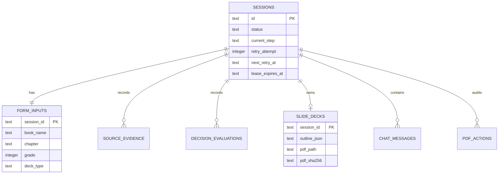
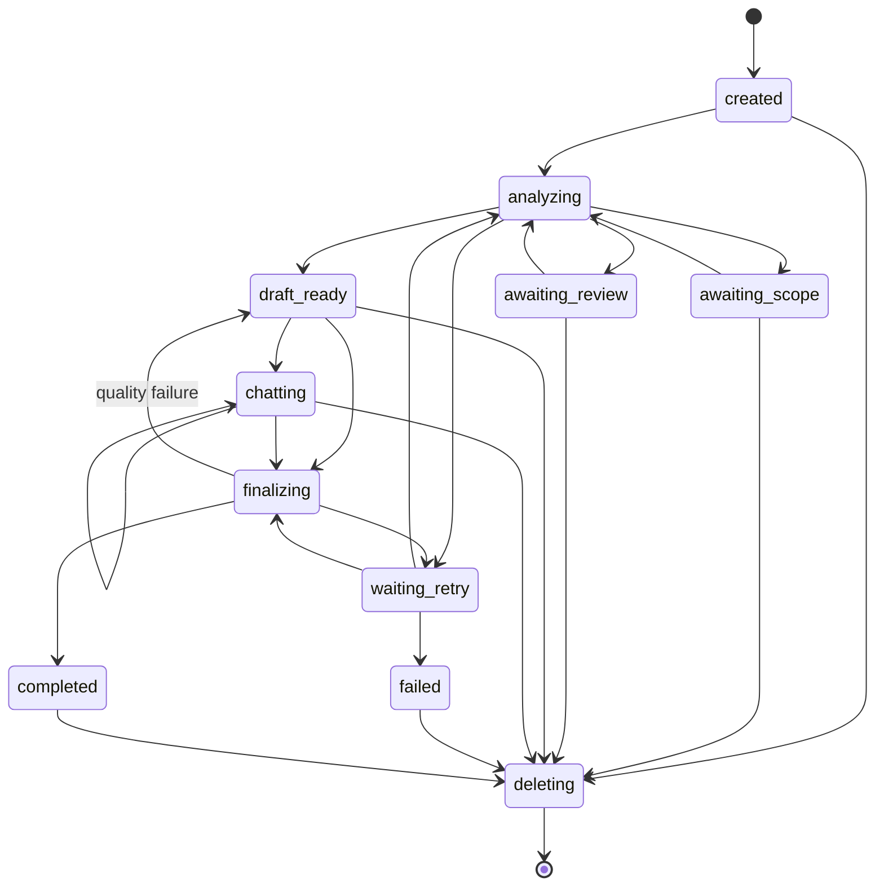
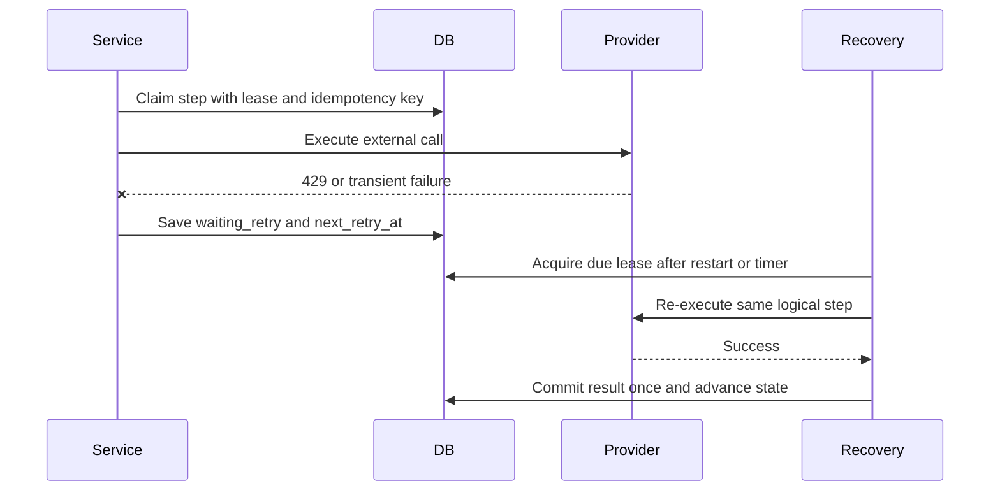

# ADR-002: Data, Jobs, and Recovery

**Date:** 2026-11-05
**Status:** Accepted
**Relates to:** [ADR-000](000-main-architecture.md)

---

## 1. Scope

This ADR defines SQLite persistence, lifecycle states, idempotency, automatic retries, restart recovery, history queries, PDF references, and deletion. It does not define AI prompt content or UI component structure.

---

## 2. Technology Documentation References

| Technology | Context7 ID or official documentation | Used for |
|---|---|---|
| Drizzle ORM | `/drizzle-team/drizzle-orm-docs` | Type-safe SQLite schema and migrations |
| better-sqlite3 | `/wiselibs/better-sqlite3` | Local Node.js SQLite driver and transactions |
| SQLite | [Official documentation](https://www.sqlite.org/docs.html) | Foreign keys, WAL, indexes, transaction behavior |
| Next.js | `/vercel/next.js` | Node route handlers and process startup integration |

---

## 3. Component Design

### 3.1 Storage configuration

- Database path: repository-root `storage/app.db`.
- Final PDF path: repository-root `storage/pdf_decks/{session_id}.pdf`.
- Resolve both to absolute server paths and reject any resolved path outside `storage/`.
- Enable SQLite foreign keys, WAL journal mode, and a bounded busy timeout when opening each connection.
- Run versioned Drizzle migrations before accepting requests.
- Use one long-lived server connection per process; do not create a connection per React render or browser request.
- Exclude the database, WAL/SHM files, PDFs, and temporary PDF files from Git.

better-sqlite3 is appropriate because the PoC has one local process, one active session, small records, and short transactions. Never hold a transaction open while calling OpenRouter or rendering a PDF.

### 3.2 Session state machine

Allowed statuses:

| Status | Meaning | Editable? |
|---|---|---:|
| `created` | Form saved; analysis not started | No chat yet |
| `analyzing` | A leased analysis step is running | No |
| `waiting_retry` | Retryable failure persisted | No |
| `awaiting_scope` | Teacher must add scope | Only resolution input |
| `awaiting_review` | Teacher must resolve evidence or conflict | Only resolution input |
| `draft_ready` | Initial outline and first message available | Yes |
| `chatting` | At least one revision turn is in progress or complete | Yes |
| `finalizing` | Approval accepted; quality/PDF step running | No |
| `completed` | Final PDF stored; session permanently closed | No |
| `failed` | Non-retryable failure or retries exhausted | No, but visible/deletable |
| `deleting` | File/database cleanup in progress | No |

No transition leaves `completed`. A closed session can only be read, downloaded, or deleted. The state machine rejects transitions not listed in a versioned transition table.

### 3.3 Logical schema

Use text UUIDs for public identifiers, UTC ISO timestamps, integer booleans, and JSON text only for bounded schema-validated aggregates. Normalize searchable and ordered records.

#### `sessions`

- Primary key: session ID.
- Interface locale, status, current step, status version.
- Created, updated, started, completed timestamps.
- Retry attempt, next retry timestamp, last retryable error code.
- Lease owner and lease expiry for recovery.
- Active marker used by a unique partial index to enforce one active session.

#### `form_inputs`

- Primary key and unique foreign key: session ID.
- Fixed subject `english`.
- Book name, chapter, optional teacher scope, grade, deck type, focus instructions.
- Normalized searchable book and chapter fields.
- Schema version.

#### `source_evidence`

- Evidence ID, session foreign key, retrieval order.
- Source URL, title, retrieval timestamp, claim summary, reliability warning.
- Unique constraint on session plus normalized URL.

#### `decision_evaluations`

- Evaluation ID, session foreign key, analysis run ID, order.
- Criterion, subject concept ID, primitive, answer.
- Full probabilities JSON, optional confidence.
- Model, provider request ID, question version, policy version, applied route.
- Created timestamp and usage JSON without prompt content.

#### `slide_decks`

- Primary key and unique foreign key: session ID.
- Structured outline JSON with schema version.
- Prompt and rule versions.
- Quality result JSON and timestamp.
- Approval timestamp.
- Final relative PDF path, byte size, SHA-256 digest, generated timestamp.
- PDF fields remain null before successful finalization.

#### `chat_messages`

- Message ID, session foreign key, monotonically increasing sequence.
- Role, typed parts JSON, delivery status, client request ID.
- Created and completed timestamps.
- Unique constraints on session plus sequence and session plus client request ID.

#### `pdf_actions`

- Action ID, session foreign key, action `generated` or `downloaded`.
- Outcome, timestamp, byte size where relevant.
- No separate draft-PDF action exists.

### 3.4 Transactions and external work

Use short transactions for state claims and result commits:

1. Transaction A validates expected state, acquires a lease, records step `running`, and commits.
2. External AI, search, or PDF work runs outside the transaction.
3. Transaction B verifies lease and expected status, persists the result, advances state once, clears retry metadata, and commits.

If the process stops between A and B, restart recovery sees an expired lease and repeats only an idempotent step. External provider request IDs are diagnostic; database idempotency keys control local duplication.

### 3.5 Retry and restart recovery

Use at most three automatic retries per failed step, with persisted delays of approximately 2 seconds, 10 seconds, and 30 seconds plus bounded jitter. Provider `Retry-After` may extend, but not shorten, the next attempt. Attempts reset only after a step succeeds.

At server startup, the recovery coordinator:

1. marks expired `analyzing` or `finalizing` leases as interrupted;
2. finds the single due retryable session;
3. atomically acquires a new lease;
4. resumes from the last incomplete idempotent step;
5. stops after success, non-retryable failure, or exhausted attempts.

While the process remains running, the same coordinator checks due work on a bounded timer. A database lease prevents duplicate work when Next.js development reloads create overlapping process instances. The browser polls session state for display; browser presence is not required for recovery.

### 3.6 PDF finalization consistency

PDF creation is a two-phase filesystem operation:

1. Render to a unique temporary file inside `storage/pdf_decks/`.
2. Validate non-zero size and readable PDF header; compute digest.
3. Atomically rename to `{session_id}.pdf` only when no final file exists.
4. Commit PDF metadata and `completed` status in SQLite.

If the file exists but the database commit was interrupted, recovery verifies digest and finalizes metadata without regenerating. If database state says completed but the file is absent or digest differs, health and download return an integrity error; they do not silently regenerate a closed session.

### 3.7 Deletion consistency

Deletion cannot be fully atomic across SQLite and the filesystem. Use a recoverable deletion workflow:

1. Validate confirmation and transition the session to `deleting`.
2. Move the final PDF, if present, to a unique temporary deletion name inside the same directory.
3. Delete all database rows through foreign-key cascade in one transaction.
4. Permanently remove the temporary file.

If a step fails, startup recovery completes deletion. The normal history API hides `deleting` sessions. No tombstone containing teacher content is retained after completion; operational logs may retain only session ID, timestamp, and outcome.

### 3.8 History queries

Use database-backed pagination with a stable `created_at DESC, id DESC` order. Search normalized book and chapter fields. Filters are grade, deck type, status, and inclusive date bounds. Default page size is 25, maximum 100. Session details load related data in bounded queries; do not expose raw provider payloads or internal prompt text.

---

## 4. Data Structures

### 4.1 Persisted job checkpoint

Each external step has:

- step name and input version;
- status and attempt count;
- idempotency key;
- lease owner and expiry;
- next attempt timestamp;
- normalized error code and safe detail;
- result reference or result hash;
- started and completed timestamps.

The first slice may store this checkpoint on `sessions` because only one step and one session run at a time. Create a separate jobs table only if parallel jobs or multiple pending operations enter scope.

### 4.2 Persisted JSON rules

Every JSON column has a Zod schema and explicit version. Read paths validate before use. Unknown newer versions fail safely with a migration-required error rather than being passed to a model or PDF renderer.

---

## 5. Interface Contracts

### 5.1 Session repository

Exposes create, get, list, transition-if-current, acquire-lease, release-lease, schedule-retry, append-message-once, save-analysis-once, and close-with-PDF-once. Every mutating method either completes atomically or reports a typed conflict.

### 5.2 Recovery coordinator

Consumes due or interrupted session checkpoints and a registry of idempotent step handlers. It never accepts arbitrary function names from persisted data. Unknown steps transition to a non-retryable migration error.

### 5.3 PDF storage

Accepts only a validated session ID and server-generated document. It returns relative path, size, digest, and timestamp. It never accepts a client path or filename.

---

## 6. Technical Decisions

### 6.1 SQLite with Drizzle and better-sqlite3

**Status:** Accepted
**Context:** The application is local, single-user, and requires searchable relational history plus durable restart state.
**Decision:** Use SQLite through Drizzle ORM and better-sqlite3 with committed migrations.
**Rejected alternatives:**

- JSON files: weak relational integrity, filtering, migration, and concurrent-update behavior.
- Postgres: requires a service and conflicts with local KISS scope.
- Prisma: valid but adds a larger generated client and migration layer without benefit for this schema.

**Consequences:**

- (+) One portable database file with transactions and indexes.
- (-) Native module installation must be verified on the target Windows/Node combination.

**Review trigger:** Hosted deployment, multiple application processes, or write contention beyond one active session.

### 6.2 Custom history route over Datasette or Streamlit

**Status:** Accepted
**Context:** History is a teacher-facing product screen with bilingual labels, downloads, deletion, and domain-specific status. A generic database dashboard exposes storage concepts and requires another process.
**Decision:** Query SQLite through application repositories and render a protected-by-locality Next.js route. Drizzle Studio may be used only as a developer tool.
**Rejected alternatives:**

- Datasette: useful inspection tool but separate runtime and unsuitable deletion/workflow UX.
- Streamlit: second application stack and duplicated navigation/design.

**Consequences:**

- (+) One coherent UI and exact domain behavior.
- (-) Search and filter views must be implemented.

**Review trigger:** An administrator or analyst persona with arbitrary database exploration enters scope.

### 6.3 Persisted leased retries

**Status:** Accepted
**Context:** The PRD requires automatic recovery while running and after restart. In-memory timers alone lose work and can duplicate after reloads.
**Decision:** Persist retry state and use short database leases around idempotent steps.
**Rejected alternatives:**

- In-memory retry only: does not survive restart.
- External queue: unnecessary service for one local job.

**Consequences:**

- (+) Restart-safe without added infrastructure.
- (-) Every external step must define idempotency and checkpoint boundaries.

**Review trigger:** Multiple simultaneous sessions or distributed workers.

---

## 7. Diagrams

### 7.1 Data relationships

### 7.2 State flow

### 7.3 Retry sequence

---

## 8. Testing Strategy

### 8.1 Test scenarios

| Scenario | Type | Input | Expected output | Edge cases |
|---|---|---|---|---|
| Migration from empty DB | Integration | Empty temporary file | All tables and indexes created | Re-run is no-op |
| One active session | Integration | Two create requests | First succeeds, second conflicts | Completed first allows next |
| Valid transition | Unit/integration | Expected state/version | One new state | Stale version conflicts |
| Message idempotency | Integration | Duplicate client request ID | One stored message | Concurrent duplicate attempt |
| Restart recovery | Integration | Expired running lease | Step reclaimed once | Two coordinators race |
| Retry exhaustion | Unit/integration | Three transient failures | Failed state after final attempt | `Retry-After` extension |
| PDF recovery | Integration | Final file exists, metadata missing | Metadata finalized once | Digest mismatch |
| History query | Integration | Mixed synthetic sessions | Stable filtered page | Same timestamps, max page size |
| Deletion | Integration | Completed session with PDF | Rows and file removed | Failure after file move |
| Path safety | Unit | Traversal-like session/path input | Rejected before filesystem access | Windows separators and casing |

### 8.2 Technical acceptance criteria

- **TAC-002-01:** Foreign keys are enabled and deleting a session removes all linked rows.
- **TAC-002-02:** A database constraint, not only UI logic, prevents two active sessions.
- **TAC-002-03:** No SQLite transaction remains open during provider or PDF work.
- **TAC-002-04:** Two recovery coordinators racing for one due step result in exactly one lease holder.
- **TAC-002-05:** Replaying a completed step with the same idempotency key does not duplicate sources, evaluations, messages, or PDF metadata.
- **TAC-002-06:** A successful final PDF path resolves under `storage/pdf_decks/` and matches its stored SHA-256 digest.
- **TAC-002-07:** History search and filters return at most 100 records in stable order.
- **TAC-002-08:** Database, WAL/SHM, PDF, and temporary files are ignored by Git.
- **TAC-002-09:** A clean application restart resumes an interrupted retryable session without an open browser.
