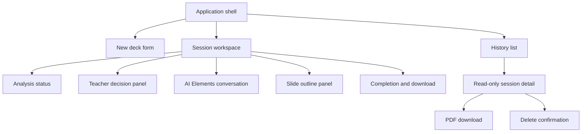
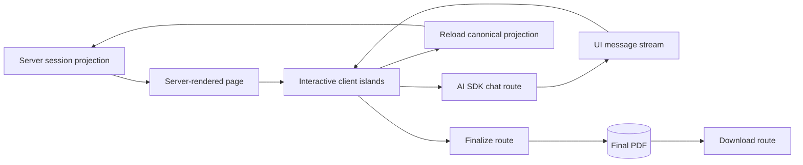
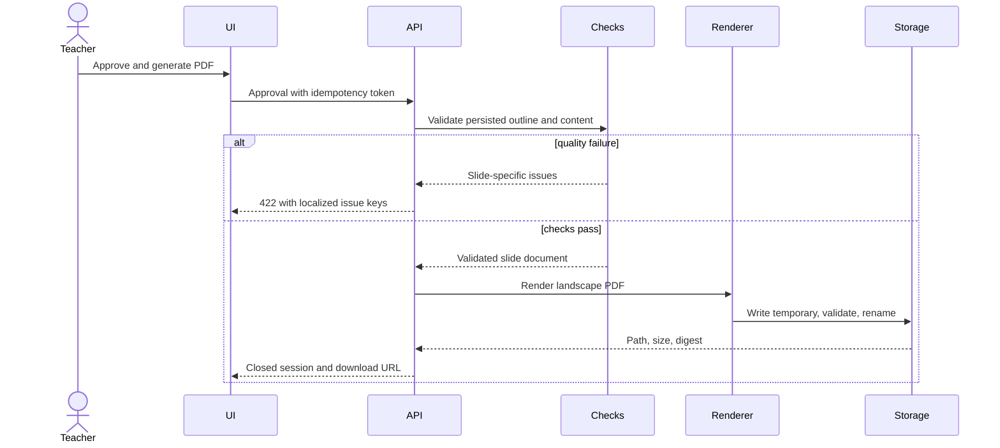

# ADR-003: Frontend, History, and PDF

**Date:** 2026-11-05
**Status:** Accepted
**Relates to:** [ADR-000](000-main-architecture.md)

---

## 1. Scope

This ADR defines the App Router screens, chat component choice, bilingual interface behavior, analysis and review UX, history browser, finalization controls, and PDF rendering. It does not define AI routing semantics or database implementation details.

---

## 2. Technology Documentation References

| Technology | Context7 ID or project reference | Used for |
|---|---|---|
| AI Elements | `/vercel/ai-elements` | Conversation, message, prompt input, source presentation primitives |
| AI SDK 7 | `/vercel/ai` | `useChat`, `DefaultChatTransport`, typed UI message parts |
| assistant-ui | `/assistant-ui/assistant-ui` | Evaluated UI alternative |
| React PDF renderer | `/diegomura/react-pdf` | Server-side `renderToBuffer` or `renderToFile` behavior |
| Next.js | `/vercel/next.js` | App Router pages, route handlers, downloads |
| Design guidelines | [Project design guidance](../design-guidelines.md) | Layout and token constraints |

---

## 3. Component Design

### 3.1 Routes

| Route | Screen | Server/client split |
|---|---|---|
| `/` | Redirect to new deck or active session | Server |
| `/new` | Form for a new session | Server shell plus client form |
| `/sessions/{id}` | Analysis, review, draft chat, or completion based on status | Server-loaded projection plus bounded client islands |
| `/history` | Searchable and filterable session list | Server page driven by URL query parameters |
| `/history/{id}` | Read-only session details | Server page; download/delete client actions |

Status, form context, and history are server-rendered from SQLite. Only interactive form state, polling, chat streaming, language switch, and confirmation dialogs require client components.

### 3.2 Application shell and localization

- Header contains product text mark, New Deck, History, and PL/EN switch.
- Store locale in a same-site cookie and allow a query/session preference to override only after validation.
- Translation dictionaries are local typed files; missing keys fail tests.
- Locale changes translate controls, validation, statuses, errors, and navigation without translating or mutating stored educational content.
- All slide content, answer keys, and agent-authored educational material remain English.
- Do not use the x-kom logo in this product. Apply the repository's neutral layout tokens and brand-inspired accents only after asset and font licensing is verified.

### 3.3 New-deck form

Use a server-validated schema shared with client validation. English is displayed as a fixed subject, not a redundant selector. Controls are book name, chapter name/number, grade 1–4, material type, and optional focus. There is no attachment component, drag-and-drop zone, or multimodal message input.

Submitting creates the session first, then navigates to its status route and starts analysis. A `409` active-session response links to the active session rather than discarding it.

### 3.4 Analysis and human decision UI

The session page maps each persisted step to a bounded progress state. It never invents percentage progress. Display:

- current step and last completed step;
- waiting/retry status and attempt count without provider internals;
- missing scope prompt;
- conflicting or insufficient evidence summary;
- source links and affected concepts;
- actions to narrow scope, nominate a public source, or continue with warning.

Disable the chat composer and finalization button until the session reaches `draft_ready` or `chatting`.

### 3.5 Chat workspace

Use selected copy-owned AI Elements components for conversation, messages, sources, and prompt input. Keep AI SDK `useChat` as the only client runtime.

Layout:

- primary column: streaming conversation;
- secondary panel: current structured slide outline with slide number, role, content summary, and task type;
- sticky action area: session status and **Approve and generate PDF**;
- first assistant message: greeting, structure, grade rationale, evidence summary, sources, and next steps;
- no download action before completion.

Render only supported message parts. Text is sanitized Markdown with raw HTML disabled. URL sources open safely and display title plus hostname. Unknown part types render a safe unsupported marker in development and are omitted with telemetry in normal use.

### 3.6 Streaming behavior

- Disable duplicate sends while the current teacher turn is being accepted.
- Show distinct submitted, streaming, completed, and failed states.
- Allow retry only for the current failed turn and reuse its client request ID.
- An interrupted stream remains visibly incomplete until the server confirms persisted status.
- Do not use optimistic assistant content as deck state. The outline panel updates only from the persisted server projection after completion.

### 3.7 History browser

Use a custom Next.js route, not Datasette or Streamlit. URL query parameters represent search and filters so reload and back navigation are stable.

List columns:

- book and chapter;
- grade and deck type;
- created date;
- status;
- PDF availability;
- open, download, and delete actions when allowed.

Session detail groups form input, lifecycle, decisions and probabilities, missing evidence, sources, transcript, outline, and final PDF metadata. It never exposes raw prompts, keys, hidden reasoning, or raw provider payloads.

Deletion uses a dialog that names the book/chapter and states that database content and the PDF will be permanently removed. Confirmation is disabled until the session projection is loaded and the exact session ID is bound to the action.

### 3.8 Finalization and PDF

The browser sends only the session ID and explicit approval intent. The server loads the accepted outline and rules, runs checks, and renders the PDF with React PDF's Node API.

PDF design constraints:

- landscape pages with one slide per PDF page;
- approximately 10 pages, bounded by approved 8–12 rule;
- one task or primary learning item per content page;
- English only;
- intro, concepts, practice, and answer key pages;
- no source links, confidence values, warnings, transcript, or internal metadata;
- deterministic typography, line limits, and overflow detection;
- footer may contain page number and neutral product name, not third-party branding.

Use bundled fonts only after license verification. Otherwise use React PDF's supported standard fonts. The renderer writes the final file only through the atomic workflow in ADR-002.

After success, replace the workspace with a completion view. The composer and approval action are absent; download, History, and New Deck remain.

---

## 4. Data Structures

### 4.1 Session projection

The UI receives a purpose-built projection containing:

- session ID, locale, public status, current step, retry summary;
- form values safe for display;
- pending teacher decision, if any;
- source links and decision summaries safe for the teacher;
- current outline;
- ordered chat UI messages;
- final PDF availability and metadata;
- allowed actions derived on the server.

Do not expose database rows directly.

### 4.2 Slide document model

Each slide contains stable ID, order, kind, title, bounded content blocks, optional task, optional answer reference, and age-guidance metadata. The PDF renderer accepts this validated model only; it never accepts Markdown, HTML, arbitrary CSS, or free-form model output.

### 4.3 Translation contract

Dictionaries contain identical typed keys for Polish and English. Educational text is not stored in translation dictionaries. Status and error codes map to locale-specific UI strings at render time.

---

## 5. Interface Contracts

### 5.1 Chat transport

The client sends session ID, stable client request ID, and one new UI message. The route returns AI SDK 7 UI message stream parts. Source URL parts are enabled. The client reloads the canonical session projection after completion or failure.

### 5.2 Finalization

Finalization requires the current server state to allow approval and an idempotency token. Success returns closed-session metadata and a download URL. Quality errors return slide IDs and message keys; they do not create or retain a draft PDF.

### 5.3 PDF download

Download verifies completed status, resolved path containment, file existence, and digest before streaming. Response headers use a safe generated filename based on session ID, not untrusted book or chapter text.

---

## 6. Technical Decisions

### 6.1 AI Elements as copy-owned UI primitives

**Status:** Accepted
**Context:** The application needs streaming chat but also a form, decision controls, outline panel, history, and a custom visual system.
**Decision:** Install only needed AI Elements components through the shadcn registry and adapt them to project tokens.
**Rejected alternatives:**

- assistant-ui: its runtime is useful for more complex assistants but duplicates AI SDK client state here.
- Current Chat SDK: targets external messaging platforms, not this browser workspace.

**Consequences:**

- (+) Direct `useChat` compatibility and local ownership.
- (-) Application must maintain copied components and accessibility tests.

**Review trigger:** Requirements for branching threads, complex interactive tools, or multi-platform bots.

### 6.2 Custom history UI

**Status:** Accepted
**Context:** Teachers need domain filters, safe details, downloads, and confirmed deletion inside the same bilingual application.
**Decision:** Build `/history` and `/history/{id}` with application queries and components.
**Rejected alternatives:**

- Embedded Datasette: generic database semantics and separate process.
- Streamlit browser: separate stack, routing, and design system.

**Consequences:**

- (+) Exact product behavior and no raw database exposure.
- (-) Pagination and filtering are application work.

**Review trigger:** A separate admin/analyst product is approved.

### 6.3 React PDF server rendering

**Status:** Accepted
**Context:** The required artifact is PDF, not an editable slide format. The app runs locally and must not depend on Office or headless browser printing.
**Decision:** Render the validated slide model with React PDF in the Node server process.
**Rejected alternatives:**

- Browser print-to-PDF: less deterministic and requires browser automation in production.
- PPTX plus LibreOffice conversion: adds external installation and conversion variability.
- PDF libraries with manual coordinates only: more layout code for text-heavy slides.

**Consequences:**

- (+) Direct PDF buffer/file generation in TypeScript.
- (-) CSS support differs from browsers; overflow requires explicit tests.

**Review trigger:** Editable PPTX export, complex animation, or unsupported typography enters scope.

---

## 7. Diagrams

### 7.1 UI component diagram

### 7.2 UI data flow

### 7.3 Finalization sequence

---

## 8. Testing Strategy

### 8.1 Test scenarios

| Scenario | Type | Input | Expected output | Edge cases |
|---|---|---|---|---|
| Bilingual shell | Component/E2E | Switch PL to EN | All UI labels change; content does not | Reload and back navigation |
| Form validation | Component/E2E | Missing required values | Field errors, no session | Whitespace and long text |
| No upload | Component/E2E | New form and chat | No attachment affordance | Pasted file rejected |
| Analysis states | Component | Each persisted status | Correct controls and explanation | Retry exhausted |
| Streaming message | Integration/E2E | Multi-chunk response | Ordered visible text and completion | Abort and reconnect |
| Sources | Component/E2E | URL source parts | Safe title/link in chat/history | Missing title, unsafe URL scheme |
| Approval gating | E2E | Pending review | Finalize disabled/rejected | Stale client state |
| PDF layout | Integration/visual | 8, 10, and 12 slide models | One landscape page per slide, no overflow | Long word, Unicode, answer key |
| Closed session | E2E | Completed session | No composer or edit action | Direct POST to chat returns conflict |
| History filters | E2E | Synthetic sessions | Correct URL-driven results | Empty result and pagination |
| Deletion dialog | E2E | Confirm/cancel | Correct irreversible or no-op behavior | PDF missing before deletion |

### 8.2 PDF verification

Automated checks verify PDF signature, non-zero size, page count, expected text, and absence of URLs/internal scores. Visual QA renders every generated page to images and checks clipping, overlap, readable text, answer-key placement, and landscape orientation. Keep representative synthetic decks for all three material types and grades 1–4.

### 8.3 Manual QA

Run the real local app and use Playwright like a teacher:

1. Create a session in each interface language.
2. Exercise analysis, one revision, approval, download, history, and deletion.
3. Verify streaming and a retry/error state.
4. Capture every touched screen and rendered PDF page.
5. Compare UI screenshots with `docs/design-guidelines.md` without copying protected brand assets.
6. Confirm no browser console errors and English-only material content.

### 8.4 Technical acceptance criteria

- **TAC-003-01:** Locale switching changes interface strings without changing stored form, outline, chat, or PDF content.
- **TAC-003-02:** No upload or attachment control exists and attachment-like chat parts are rejected.
- **TAC-003-03:** Every streamed assistant turn has visible submitted, streaming, and terminal state.
- **TAC-003-04:** A completed session renders no editable composer or finalization action, and server routes also reject edits.
- **TAC-003-05:** Every final PDF has 8–12 landscape pages, one PDF page per slide, and no source URL or internal decision score.
- **TAC-003-06:** Download verifies path containment and stored digest before returning the file.
- **TAC-003-07:** History supports stable search, filters, detail, download, and confirmed deletion without exposing raw database or provider data.
- **TAC-003-08:** Automated accessibility checks find no critical violations on New Deck, Session, Completion, History, or Delete Confirmation screens.
