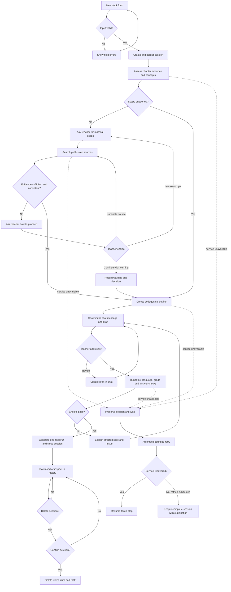

# PRD — Exam Material Generator Copilot: Slide Deck Variant

---

## 1. Executive Summary

This PoC helps primary-school English teachers create an approximately 10-slide exam-preparation deck from a book name, chapter, teacher-defined scope, and grade level. The product researches public web sources when the model cannot reliably identify the requested material, lets the teacher refine a draft in chat, and creates one final English-language PDF after explicit approval.

---

## 2. Problem Statement

Teachers spend time converting book chapters into age-appropriate revision materials, exercises, and answer keys. They must also check whether generated content matches the intended chapter, is linguistically correct, and is suitable for pupils in grades 1–4. General-purpose AI tools do not provide a bounded workflow for source checking, uncertainty handling, iterative editing, final PDF generation, and local session history.

---

## 3. Users / Personas

### 3.1 Primary-school English teacher

Teaches one or more classes in grades 1–4. Wants a short deck aligned with a named book chapter and expects correct English, age-appropriate instructions, varied exercises, and an answer key.

### 3.2 Individual English teacher

Prepares revision material for a specific pupil or small group in grades 1–4. Wants to adjust difficulty and emphasis through chat before approving a reusable PDF.

Students, parents, administrators, and content publishers are not direct users of the PoC.

---

## 4. Main Flows

### 4.1 Create and finalize a deck

1. The teacher starts a new session and selects the Polish or English interface.
2. The product displays English as the fixed subject and asks for the book name, chapter name or number, grade (1–4), material type, and optional focus instructions.
3. The teacher submits the form.
4. The product evaluates whether it has enough evidence to identify the chapter scope and records its conclusions, confidence, uncertainty, and missing evidence.
5. If the scope is sufficiently supported, the product extracts core concepts and builds an approximately 10-slide outline using the applicable pedagogical rules.
6. The first agent message greets the teacher and presents the proposed structure, age-adaptation choices, evidence summary, sources used outside the deck, and suggested next steps.
7. The teacher requests changes in chat, such as changing difficulty, editing a slide, or adding a different exercise type.
8. The product updates the draft while preserving the form context, evidence, decisions, and full session conversation.
9. The teacher selects **Approve and generate PDF**.
10. The product checks thematic and linguistic correctness, generates one final English-language PDF, closes the session, and displays a download action.
11. The closed session remains viewable, downloadable, and deletable, but cannot be edited or reopened.

### 4.2 Resolve an unknown or weakly supported chapter

1. The product determines that the book or chapter cannot be identified with sufficient evidence.
2. The agent asks the teacher to describe the required material scope.
3. After receiving the scope, the product searches public web sources and records the source links, relevance, and unresolved gaps.
4. If the evidence becomes sufficient, the product returns to the normal draft flow.
5. If sources conflict, appear unreliable, or still do not support the requested scope, the agent explains the issue and asks the teacher whether to narrow the scope, nominate a source, or continue with a visible warning.
6. The product follows the selected option. It does not silently resolve the conflict or claim that the content comes from the named book.

### 4.3 Recover from an unavailable dependency

1. An AI or web-search operation fails because a required service is unavailable.
2. The product preserves the session, current input, conversation, and completed analysis.
3. The session displays a waiting-for-recovery status and the failed step.
4. The product retries automatically using a bounded retry policy.
5. When the service recovers, processing resumes from the failed step without duplicating messages or losing teacher changes.
6. If automated retries are exhausted, the session remains preserved and explains that processing is still incomplete.

### 4.4 Browse and remove history

1. The teacher opens the integrated history view.
2. The product lists past and incomplete sessions with search, filters, status, key form values, decision summary, and PDF availability.
3. The teacher opens a session to inspect its inputs, conversation, evidence, sources, decision scores, outline, processing events, and final PDF metadata.
4. The teacher may download the final PDF from a completed session.
5. The teacher may request deletion of a session, including for suspected copyright infringement.
6. After explicit confirmation, the product deletes the session data and linked PDF and removes the item from history.

---

## 5. User Stories

- As a grades 1–4 English teacher, I want to create a deck from a book and chapter reference so that I can prepare revision material without designing every slide manually.
- As a teacher, I want the draft adapted to a selected grade so that its vocabulary, instructions, and tasks are appropriate for my pupils.
- As a teacher, I want to choose flashcards, a summary, or a quiz and practice deck so that the material matches my lesson goal.
- As a teacher, I want to refine the draft in chat before PDF generation so that I retain editorial control.
- As a teacher, I want the agent to disclose missing or conflicting evidence so that I do not mistake generated content for verified textbook content.
- As a teacher, I want failed sessions to resume automatically so that a temporary service outage does not discard my work.
- As a teacher, I want to search past sessions and download final PDFs so that I can reuse completed material.
- As a teacher, I want to delete a session and its PDF so that I can remove obsolete or potentially infringing material.

---

## 6. Acceptance Criteria

### 6.1 Form and session creation

- **AC-01:** The new-session form identifies English as the only supported subject.
- **AC-02:** The form requires a non-empty book name, chapter name or number, grade from 1 through 4, and one of: Flashcard Slides, Summary Deck, or Quiz & Practice Deck.
- **AC-03:** Special focus instructions are optional and are included in the session context when provided.
- **AC-04:** Submitting valid input creates a session and preserves the submitted values before analysis starts.
- **AC-05:** Submitting missing or invalid required input does not start analysis and identifies every field requiring correction.
- **AC-06:** The product does not offer textbook image, document, or chapter-file upload.

### 6.2 Evidence and concept analysis

- **AC-07:** Every analysis reports concept-match categories with probabilities or confidence scores and states the supporting evidence, missing evidence, and unresolved uncertainty.
- **AC-08:** A low concept-match probability may be recorded as a confident exclusion and is not automatically labeled uncertain.
- **AC-09:** The product never states that generated content is verified against a named book when it has no reliable access to that book's chapter content.
- **AC-10:** When the chapter scope cannot be established, the agent asks the teacher for the material scope before creating an outline.
- **AC-11:** After the teacher supplies the scope, the product searches public web sources and stores the source title, link, retrieval time, and relationship to the requested scope.
- **AC-12:** Sources used during research are visible in the chat and session history but are not printed in the generated deck.
- **AC-13:** When evidence remains conflicting, unreliable, or insufficient, the product asks the teacher to narrow the scope, nominate a source, or continue with a warning.
- **AC-14:** The product does not continue past an unresolved evidence decision until the teacher selects an offered action.

### 6.3 Pedagogical structure

- **AC-15:** A generated deck targets approximately 10 slides; any draft outside the range of 8–12 slides explains the reason in chat before approval.
- **AC-16:** Each content slide contains at most one task or one primary learning item.
- **AC-17:** Each deck contains an introduction, concept presentation, practice, and an answer key appropriate to its included tasks.
- **AC-18:** Grade 1–2 material uses short instructions, common vocabulary, one-step tasks, and concrete examples.
- **AC-19:** Grade 3–4 material may use longer instructions and limited inference but avoids unexplained vocabulary beyond the declared chapter scope.
- **AC-20:** Every deck type uses at least two task formats where practice tasks are present, unless the teacher explicitly requests a single format.
- **AC-21:** Flashcard Slides prioritize one English prompt, term, phrase, or example per content slide.
- **AC-22:** Summary Deck prioritizes concise concept explanations, examples, recap practice, and answers.
- **AC-23:** Quiz & Practice Deck prioritizes varied questions, one task per slide, and a final answer key.

### 6.4 Agent and chat

- **AC-24:** The first agent message contains a greeting, structure overview, grade-suitability justification, evidence summary, source links when research was used, and next steps.
- **AC-25:** The first agent message does not contain a PDF download link because no final PDF exists before teacher approval.
- **AC-26:** The agent retains the form values, analysis, teacher decisions, sources, current outline, and full chat history throughout an open session.
- **AC-27:** A teacher can request changes to specific slides, difficulty, wording, age nuance, or practice questions before approval.
- **AC-28:** The Summary Deck and Quiz & Practice Deck use distinct instruction sets; Flashcard Slides use a third instruction set appropriate to flashcards.
- **AC-29:** The agent does not invent textbook evidence, source claims, quotations, or research results.
- **AC-30:** The agent does not override a pending teacher decision or a human-review-required state.

### 6.5 Language and content quality

- **AC-31:** The interface can be switched between Polish and English without changing the current session data.
- **AC-32:** Slide content, exercise instructions, answers, and agent-generated educational material are always in English, regardless of interface language.
- **AC-33:** Generated slide content paraphrases source material and does not reproduce passages from a book or web page.
- **AC-34:** Before approval is accepted, the product evaluates the draft for consistency with the declared topic, English-language correctness, answer-key consistency, and the selected grade rules.
- **AC-35:** A failed quality check blocks final PDF generation and identifies the affected slide and issue in chat.

### 6.6 Approval and PDF

- **AC-36:** The product generates a final PDF only after the teacher explicitly selects **Approve and generate PDF**.
- **AC-37:** The final PDF contains the approved English deck and no citations, source links, confidence scores, internal warnings, or chat transcript.
- **AC-38:** A session has at most one stored final PDF.
- **AC-39:** Successful PDF generation closes the session and records the generation action and file reference.
- **AC-40:** A closed session cannot be edited, resumed, or used to replace its final PDF.
- **AC-41:** The final PDF can be downloaded from the completion view and from session history.

### 6.7 Failure recovery

- **AC-42:** When an AI or search operation is unavailable, the product preserves the session and marks the failed step as waiting for recovery.
- **AC-43:** Automatic retry resumes from the failed step and does not duplicate completed agent or teacher messages.
- **AC-44:** Retry attempts are bounded; after the configured limit is exhausted, the session remains preserved with an incomplete status and a visible explanation.

### 6.8 History and deletion

- **AC-45:** History lists open, waiting, review-required, completed, failed, and deleted-session outcomes where applicable.
- **AC-46:** The teacher can search history by book or chapter and filter by grade, deck type, status, and creation date.
- **AC-47:** Session details show form input, decisions and scores, missing evidence, source links, chat messages, slide outline, processing status, and final PDF metadata when available.
- **AC-48:** Deletion requires explicit confirmation naming the session and warning that its data and PDF cannot be recovered through the product.
- **AC-49:** Confirmed deletion removes the session's linked records and final PDF from normal product access.
- **AC-50:** Canceling the confirmation leaves the session and PDF unchanged.

### 6.9 Persistence

- **AC-51:** Sessions, form inputs, decision evaluations, slide-deck state, chat messages, source evidence, retry state, and PDF actions survive an application restart.
- **AC-52:** The local data model maintains one session-to-one form-input relationship and one session-to-zero-or-one final-PDF relationship.
- **AC-53:** Decision evaluations and chat messages retain their creation order within a session.

---

## 7. Out of Scope

- **User accounts and authentication:** The PoC is a personal, single-teacher application without login or role management.
- **Multi-user collaboration:** No shared workspaces, concurrent editing, comments, or teacher-to-teacher sharing.
- **Learner access:** No student portal, assignment delivery, submission collection, grading, or progress tracking.
- **Learning management systems:** No LMS integration, gradebook synchronization, or classroom platform export.
- **Official validation:** No curriculum certification, grade certification, publisher approval, or guarantee of complete chapter coverage.
- **Source uploads:** No textbook image, page, or PDF upload and no OCR or image-legibility analysis.
- **RAG knowledge base:** No internal curriculum, pedagogy, or glossary retrieval system in the PoC.
- **Editable presentation formats:** No PPTX, Google Slides, or presentation-editor export.
- **Notifications:** No email, push, or desktop notifications.
- **Mobile applications:** No native mobile or tablet application.
- **Additional subjects and levels:** No subjects other than English and no levels outside primary-school grades 1–4.
- **Publishing and commerce:** No public deck catalog, marketplace, licensing workflow, or payment handling.

---

## 8. Constraints

### 8.1 Business

- Only synthetic or teacher-entered data and publicly accessible web evidence may be used in the PoC.
- Teachers retain the final editorial decision and responsibility for classroom use.
- The product must state that generated material is not officially certified or guaranteed to cover the complete named chapter or curriculum.
- Research must not bypass paywalls, access controls, or publisher restrictions.
- Source-derived content in the deck must be paraphrased; source attribution remains available in chat and history.

### 8.2 Functional

- The application is personal and local, with no login.
- English is the only knowledge domain and output-material language.
- Supported educational levels are grades 1, 2, 3, and 4 of primary school.
- Supported material types are Flashcard Slides, Summary Deck, and Quiz & Practice Deck.
- Interface controls and system navigation support Polish and English.
- Each completed process stores one final PDF; draft PDFs are not retained.
- Closed sessions are immutable and cannot be reopened.
- A teacher may permanently delete an old session and its linked PDF after confirmation.
- AI, web-search, PDF, and retry-provider limits must be validated and documented in the ADR before implementation.

### 8.3 Local persistence and logical schema

The PoC uses local SQLite persistence at `storage/app.db`. Final PDFs are stored as `storage/pdf_decks/{session_id}.pdf`. SQL types, indexes, migration mechanics, and deletion implementation belong in the ADR.

| Record | Required product data |
|---|---|
| `sessions` | Session identifier, interface locale, lifecycle status, current processing step, retry state, timestamps, completion state, and deletion state |
| `form_inputs` | Session reference, fixed subject, book name, chapter, teacher-provided scope, grade, material type, and special instructions |
| `decision_evaluations` | Session reference, evaluated concept or issue, category, probability/confidence, evidence, missing evidence, uncertainty, source references, and teacher resolution |
| `slide_decks` | Session reference, current outline, selected deck type, quality-check outcome, approval state, final PDF reference, and generation timestamp |
| `chat_messages` | Session reference, sender, language, ordered content, timestamp, and relationship to a decision or deck revision when applicable |
| `source_evidence` | Session reference, source title, public link, retrieval timestamp, relevance, supported claim, and reliability warning |
| `pdf_actions` | Session reference, generation or download action, timestamp, outcome, and final PDF reference |

Deletion must remove or make inaccessible all records and files linked to the selected session. Any minimal deletion evidence required for operational integrity must not retain the generated content or teacher-entered material.

### 8.4 Prompt and guidance references

These are separate product-controlled documents injected into the relevant generation step. Their exact paths and prompt assembly are ADR decisions.

| Document | Initial content | When used |
|---|---|---|
| Age-adaptation guidelines | Grades 1–2: short instructions, common words, one-step tasks, concrete examples. Grades 3–4: short multi-step instructions, controlled new vocabulary, limited inference. | Outline creation, chat revisions, and final quality review |
| Slide styling examples | Approximately 10 slides; one task or learning item per content slide; concise headings; no source list inside the deck. | Outline and slide-content generation |
| Flashcard prompt | One prompt, term, phrase, or example per content slide, with recap practice and answers where applicable. | Flashcard Slides sessions |
| Summary prompt | Intro, core concepts, examples, recap practice, and answer key. | Summary Deck sessions |
| Quiz prompt | Intro and instructions, varied one-task-per-slide practice, then answer key. | Quiz & Practice Deck sessions |

---

## 9. UI Description (wireframe level)

### 9.1 Application shell

- A header contains the product name, New Deck and History navigation, and a PL/EN interface-language switch.
- Changing the interface language updates labels, actions, validation messages, and statuses without translating or resetting session content.
- The current session status remains visible during analysis and chat.

### 9.2 New deck form

- The main area shows English as the fixed subject.
- Inputs collect book name, chapter name or number, grade 1–4, material type, and optional focus instructions.
- A primary action starts analysis.
- Inline errors appear beside invalid required fields.
- No upload control is present.

### 9.3 Analysis and scope clarification

- A progress area shows the current bounded step: interpreting request, checking evidence, waiting for scope, researching sources, extracting concepts, or building outline.
- If scope is missing, the chat asks the teacher for it and keeps the original form visible as read-only context.
- Conflicting evidence displays a concise explanation, affected claims, source links, and actions to narrow scope, nominate a source, or continue with a warning.
- Service failure displays the preserved-session status and automatic-retry state.

### 9.4 Draft chat workspace

- The main column contains the ordered chat conversation.
- The initial agent bubble shows the proposed structure, age rationale, evidence summary, research sources when applicable, and suggested changes.
- A draft-outline panel shows slide number, purpose, content summary, and task type.
- The teacher can send revision instructions while the session is open.
- **Approve and generate PDF** remains unavailable while an evidence decision or quality error is unresolved.
- No PDF download action appears before final generation.

### 9.5 Completion view

- The view confirms that the process is closed and cannot be reopened.
- It shows the final outline summary and a download action for the single final PDF.
- It links to History and New Deck.
- Chat input and editing controls are absent or disabled.

### 9.6 History browser

- The history list includes book, chapter, grade, deck type, creation date, status, and PDF availability.
- Search covers book and chapter. Filters cover grade, deck type, status, and date.
- The empty state explains that completed and incomplete sessions will appear after a process starts.
- Selecting an item opens session details without enabling edits.
- Each item provides a delete action; completed items with an available PDF also provide download.

### 9.7 Session details and deletion

- Session details group form input, processing status, decisions, scores, missing evidence, sources, transcript, outline, and PDF metadata.
- A destructive delete action opens a confirmation showing the session identity and irreversible effect.
- Confirming returns to history after linked data and the PDF are removed; canceling returns to unchanged details.

---

## 10. User Flow Diagram

---

## 11. Agent / System Behavior Specification

### 11.1 Role

The agent is an English exam-material drafting copilot for teachers of grades 1–4. It converts bounded form context and supported concepts into a pedagogically structured draft, explains its choices, supports revisions, and prepares content for final PDF generation.

### 11.2 Allowed behavior

- Extract and organize concepts that are supported by the teacher's scope, reliable evidence, or clearly labeled general model knowledge.
- Search public web sources when the requested chapter is not sufficiently known.
- Propose age-appropriate wording, examples, flashcards, summaries, questions, and answer keys.
- Explain uncertainty, exclusions, source conflicts, and missing evidence.
- Ask focused questions required to proceed.
- Apply teacher-requested revisions while the session remains open.

### 11.3 Prohibited behavior

- Claim access to or verification against textbook content that was not reliably available.
- Invent citations, quotations, chapter contents, source results, or confidence evidence.
- Copy source passages into generated slides.
- Treat every low probability as uncertainty when the result supports a confident exclusion.
- Override unresolved review status, pending teacher choice, or a failed quality check.
- Certify curriculum alignment, learning outcomes, pupil ability, or official exam readiness.
- Edit or regenerate a closed session.

### 11.4 Decision categories

| Category | Meaning | Communication |
|---|---|---|
| Supported | Evidence supports inclusion in the requested scope. | Show concept, evidence basis, and confidence. |
| Confident exclusion | Evidence supports that the concept is outside the requested scope. | Show the exclusion and reason; do not label it uncertain solely because match probability is low. |
| Uncertain | Evidence is incomplete or ambiguous. | State what is uncertain and what input could resolve it. |
| Conflicting evidence | Credible sources disagree or point to different chapter scopes. | Present the conflict and ask the teacher how to proceed. |
| Insufficient evidence | No reliable basis exists for a chapter-specific claim. | Ask for scope and research it; do not infer hidden textbook content. |
| Human decision required | The system cannot safely choose among available options. | Pause the affected step until the teacher selects an action. |

Probabilities and confidence scores must always be paired with a category and explanation. They are decision support, not proof of curriculum coverage.

### 11.5 Mandatory notices

Before approval, the chat must state that:

- the deck is AI-generated and requires teacher review;
- chapter and curriculum coverage are not guaranteed;
- the product does not provide official certification or publisher approval;
- web research sources are available in the session record but omitted from the deck.

### 11.6 Off-topic requests

The agent briefly states that the session is limited to preparing the current English deck and redirects the teacher to the active outline. It may answer clarification questions about its evidence or drafting choices but does not perform unrelated general-assistant tasks.

### 11.7 Language and tone

- Navigation and system messages follow the selected Polish or English interface language.
- Educational content, deck text, answers, and agent-authored material guidance are in English.
- The agent uses concise, teacher-facing language, distinguishes fact from inference, and names uncertainty directly.

---

## 12. Further Notes

- The exact providers for the language model, web search, and PDF generation are ADR decisions.
- The bounded automatic-retry count and timing must be selected in the ADR after provider limits are known.
- The meaning and calibration of confidence scores must be defined before implementation; arbitrary numeric precision is not acceptable.
- The initial guidance examples in Section 8 are fictional product rules, not official curriculum standards.
- A future RAG knowledge base may add curriculum standards, pedagogical guides, and glossaries, but it must not be assumed by the PoC.
